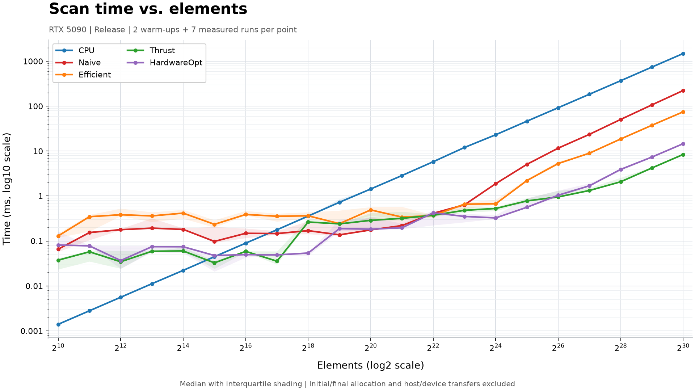
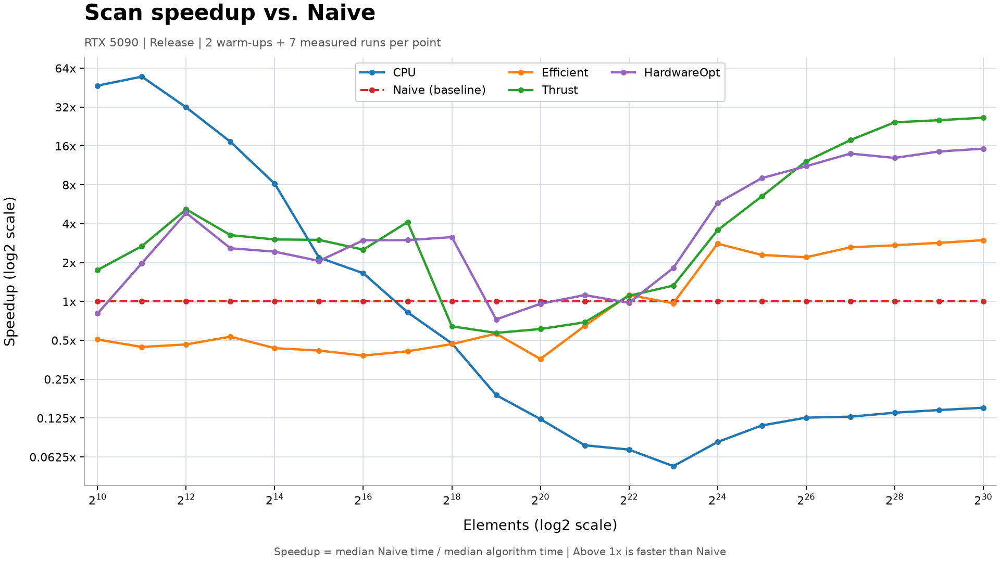

CUDA Stream Compaction
======================

**University of Pennsylvania, CIS 565: GPU Programming and Architecture, Project 2**

* (TODO) YOUR NAME HERE
  * (TODO) [LinkedIn](), [personal website](), [twitter](), etc.
* Tested on: Windows 11 Pro for Workstations (10.0.26300), Intel Core i9-13900K, 128 GB RAM, NVIDIA GeForce RTX 5090 (32 GB VRAM)
  * CUDA 13.4 (NVCC 13.4.92), NVIDIA driver 617.14, Visual Studio 2026 Community (MSVC 14.51.36231), CMake 4.4.4; Release build

### Scan performance

The following charts compare CPU, Naive, Efficient, Thrust, and HardwareOpt scan
over all 21 power-of-two sizes from `2^10` (1,024) to `2^30` (1,073,741,824)
elements. Non-power-of-two cases and stream compaction are not included.

**Measurement setup:** NVIDIA GeForce RTX 5090 (32 GB), Intel Core i9-13900K,
Windows 11, CUDA 13.4, and a Release build without a debugger. Each
algorithm/size pair has two warm-up runs followed by seven measured runs;
the charts use the median. Algorithm order rotates between sizes.

Input is deterministic 32-bit integer data: `input[i] = (i % 7 != 0) ? 1 : 0`.
This avoids signed prefix-sum overflow even at `2^30`. Every output element is
checked after warm-up and after the final measured run against the independent
reference `output[i] = i - (i + 6) / 7`.

CPU measurements use the existing `std::chrono` timer; GPU measurements use
the existing CUDA-event timers. Initial/final allocation and host-device
transfers are outside the measured scan intervals. Internal implementation
overheads, such as Thrust's temporary-storage management and kernel scheduling,
may remain inside those intervals. These are computation-interval timings,
not end-to-end application latencies.

#### Time versus elements

Both axes are logarithmic: base 2 for elements and base 10 for milliseconds.
Markers show medians; shading shows the 25th-75th percentile of the seven runs.



#### Speedup relative to Naive

For each element count, `speedup = median Naive time / median algorithm time`.
Naive is the dashed `1x` baseline; values above `1x` are faster than Naive.
Both axes use base-2 logarithmic scales to show CPU and GPU results across the
full range without flattening the smaller values.



Data: [all 735 timing samples](img/scan_benchmark_samples.csv),
[medians, quartiles, and speedups](img/scan_benchmark_summary.csv),
and [environment, methodology, and source fingerprints](img/scan_benchmark_metadata.json).
Results are specific to this device and these implementation versions; they
do not establish a universal ranking.

Charts use matplotlib 3.11.2 in a local uv-managed environment:

```powershell
uv venv .venv
uv pip install --python .venv\Scripts\python.exe matplotlib==3.11.2
```

### Extra-credit modules

`stream_compaction/radix_sort.cu` provides `RadixSort::sort`, and
`stream_compaction/efficient_hardware_opt.cu` provides
`EfficientHardwareOpt::scan` and `EfficientHardwareOpt::compact`.
Radix sort remains a TODO stub; direct calls throw `std::logic_error`.
Hardware-optimized scan uses shared-memory tiles and a work-efficient scan of
tile totals. Hardware-optimized compaction maps input to flags, scans them on
the device, and scatters nonzero elements in their original order. It returns
the valid output count and copies only those elements to the host.

Each module has its own `PerformanceTimer` with owner-only GPU timing, so
nested calls do not restart or stop an outer measurement. The source macros
`STREAM_COMPACTION_RADIX_SORT_ENABLE_TIMING` and
`STREAM_COMPACTION_EFFICIENT_HARDWARE_OPT_ENABLE_TIMING` default to `1`.

`src/main.cpp` includes power-of-two and non-power-of-two cases for all three
functions. Hardware-optimized scan and compaction are called directly, matching
the existing test layout, and use the CPU reference results.
Radix sort remains skipped by default; enable `TEST_RADIX_SORT` after implementing
it. Sorting is compared with `std::sort`.

### Windows build

With Visual Studio 2026 C++ tools, CUDA 13.4, and a compatible CMake on `PATH`:

```powershell
cmake -S . -B build -G "Visual Studio 18 2026" -A x64 -T cuda=13.4
cmake --build build --config Debug
```

Use a fresh build directory if an existing CMake cache selects a different
generator, platform, or toolset. CMake enables MSVC's conforming preprocessor
(`/Zc:preprocessor`) for CUDA sources, as required by CUDA 13.4's Thrust headers.

In Debug and RelWithDebInfo builds, project kernels retain CUDA device debugging
(`-G`), but `thrust.cu` uses line information (`-lineinfo`) without `-G`.
Unoptimized Thrust/CUB kernels can exceed the default GPU stack and fail with
CUDA error 719. This exception preserves source line information without changing
the device-wide stack limit; full device debugging is unavailable for `thrust.cu`.

### CPU timing

`STREAM_COMPACTION_CPU_ENABLE_TIMING` in `cpu.cu` controls automatic CPU timing
for `scan`, `compactWithoutScan`, and `compactWithScan`. With the macro set to
`1`, only the call that starts `CPU::timer()` ends it; nested calls preserve the
outer measurement. Set it to `0` to disable automatic timing without affecting
explicit caller-side timing or the previous elapsed value. Empty scans return
without changing timer state. No CMake option is needed.

### Efficient scan: per-level thread compaction

Each up-sweep and down-sweep level uses `n / offset` logical workers, where `n`
is the padded power-of-two length. The grid is recomputed inside each level's
loop, rounding up to blocks of 256 threads. Worker `tid` handles the group
starting at `tid * offset`; excess threads in the last block return immediately.
This avoids launching a full-array grid when only a few tree nodes need work.

Kernels in the same stream execute in order, so per-level host synchronization
is omitted; launch checks and end-of-sweep synchronization remain. The original
indexing, fixed grid, and per-level synchronization are preserved as comments
in `efficient.cu`.

### Shared-memory scan reference (pseudocode)

This is a reference design, not an implemented feature. It extends the scan in
[GPU Gems 3, Chapter 39, Sections 39.2.2 and 39.2.4](https://developer.nvidia.com/gpugems/gpugems3/part-vi-gpu-computing/chapter-39-parallel-prefix-sum-scan-cuda).


### Efficient timing

Automatic GPU timing in `Efficient::scan` and `Efficient::compact` is enabled by
default. A call starts and stops `Efficient::timer()` only if that timer was not
already running. Nested calls leave the outer measurement untouched; explicit
caller-side timing must use the same `Efficient::timer()` instance.

The source-level macro `STREAM_COMPACTION_EFFICIENT_ENABLE_TIMING` at the top of
`efficient.cu` defaults to `1`; set it to `0` to disable automatic timing.
No CMake option is needed. Explicit caller-side timing remains available.

### (TODO: Your README)

Include analysis, etc. (Remember, this is public, so don't put
anything here that you don't want to share with the world.)
