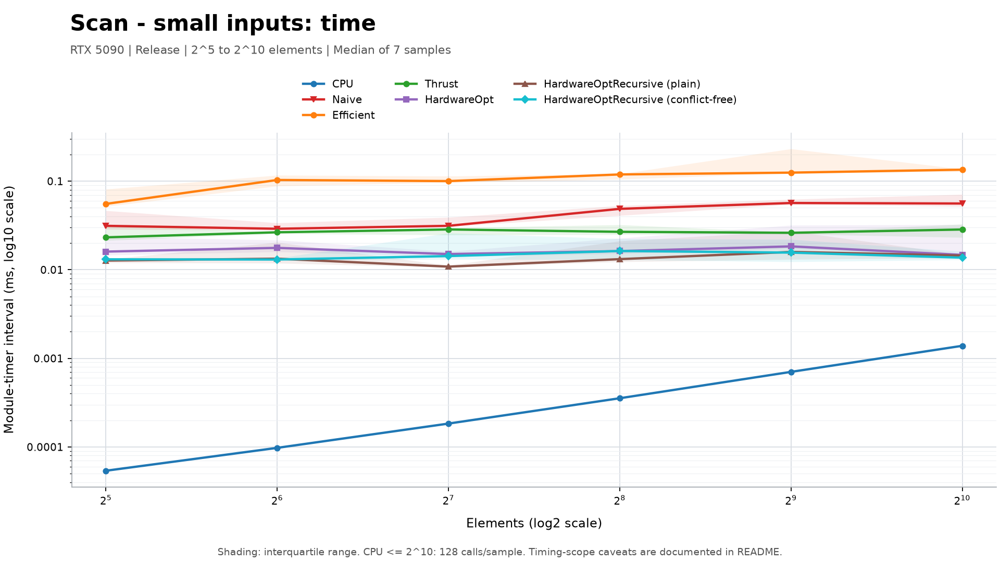
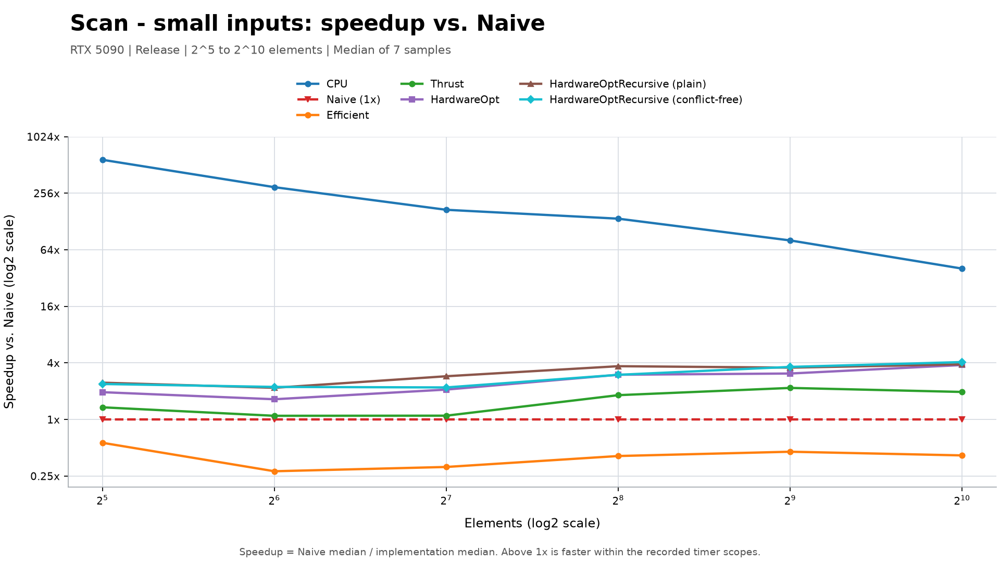
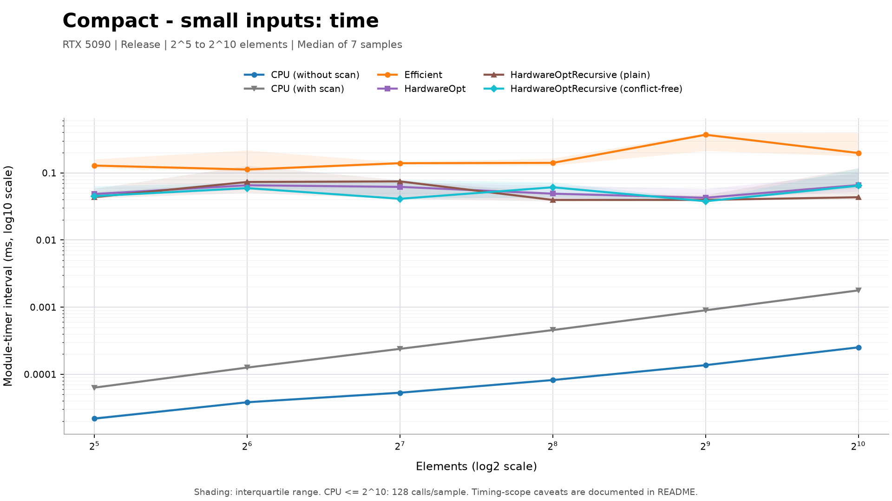
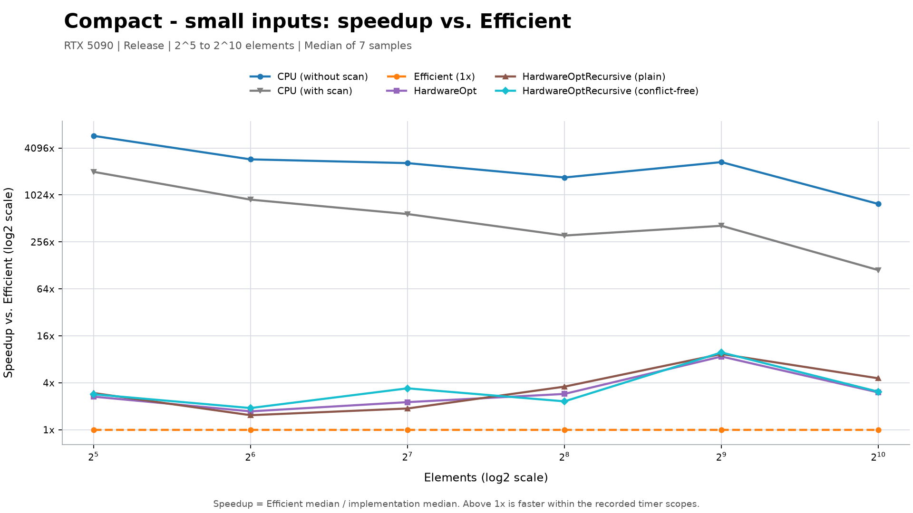
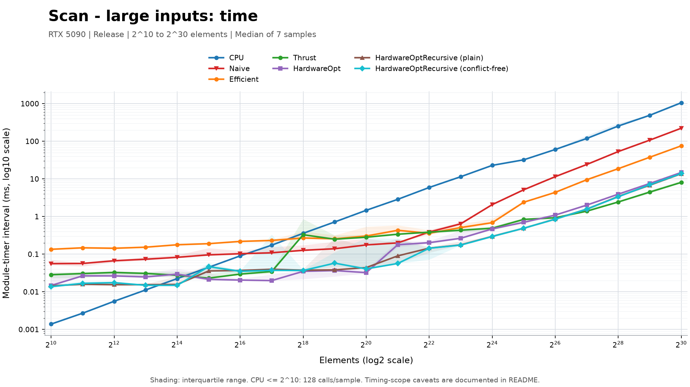
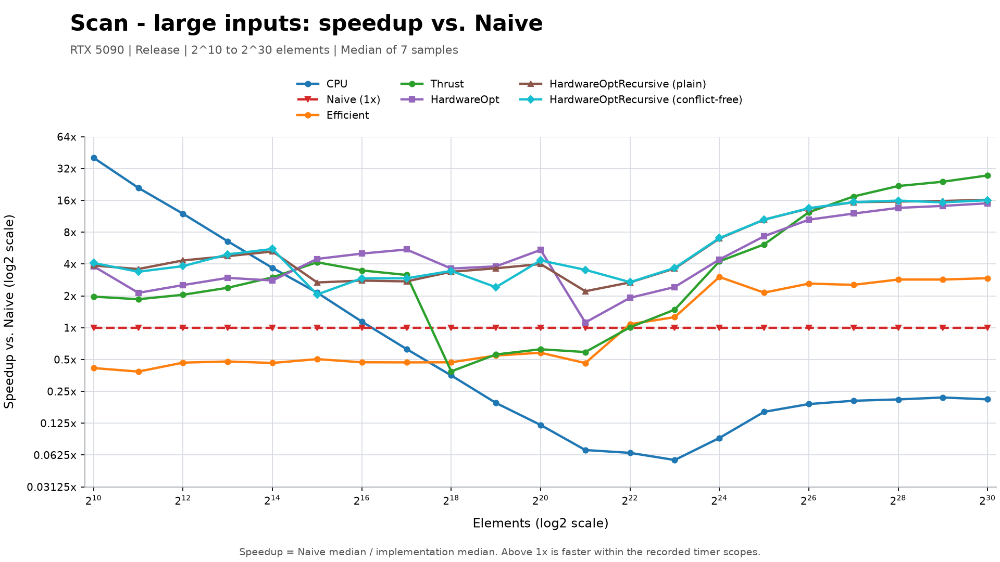
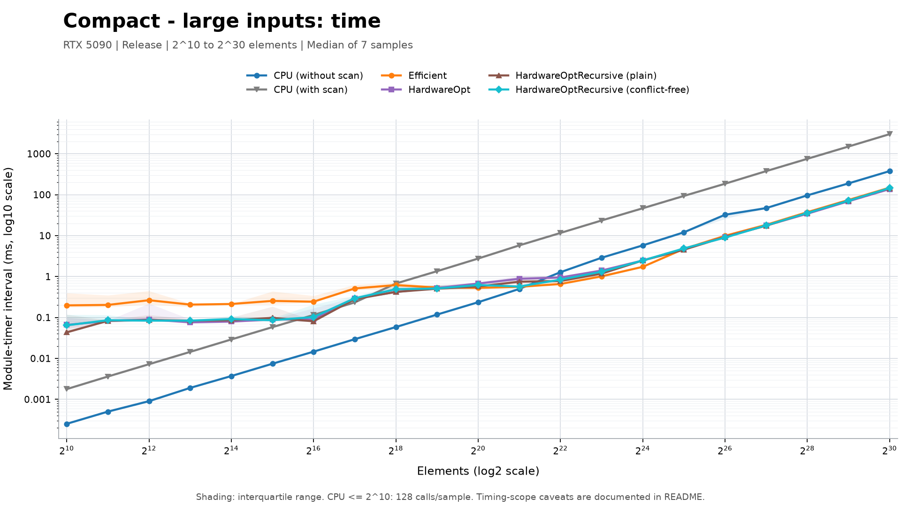
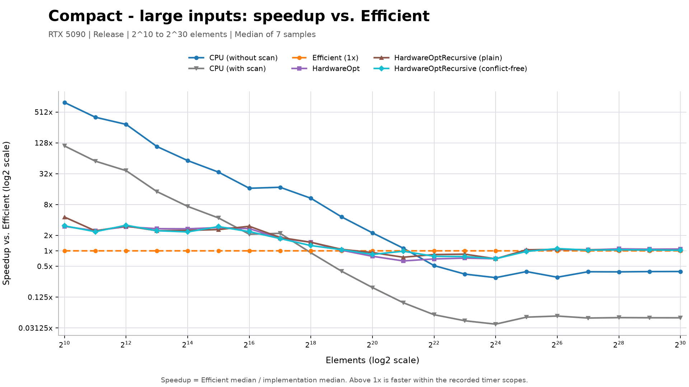

CUDA Stream Compaction
======================

**University of Pennsylvania, CIS 565: GPU Programming and Architecture, Project 2**

* (TODO) YOUR NAME HERE
  * (TODO) [LinkedIn](), [personal website](), [twitter](), etc.
* Tested on: Windows 11 Pro for Workstations (10.0.26300), Intel Core i9-13900K, 128 GB RAM, NVIDIA GeForce RTX 5090 (32 GB VRAM)
  * CUDA 13.4 (NVCC 13.4.92), NVIDIA driver 617.14, Visual Studio 2026 Community (MSVC 14.51.36231), CMake 4.4.4; Release build

### Extra-credit modules

`stream_compaction/radix_sort.cu` provides `RadixSort::sort`, and
`stream_compaction/efficient_hardware_opt.cu` provides
`EfficientHardwareOpt::scan` and `EfficientHardwareOpt::compact`.
Radix sort remains a TODO stub; direct calls throw `std::logic_error`.
Hardware-optimized scan uses shared-memory tiles and a work-efficient scan of
tile totals. Hardware-optimized compaction maps input to flags, scans them on
the device, and scatters nonzero elements in their original order. It returns
the valid output count and copies only those elements to the host.

Each module has its own `PerformanceTimer` with owner-only GPU timing, so
nested calls do not restart or stop an outer measurement. The source macros
`STREAM_COMPACTION_RADIX_SORT_ENABLE_TIMING` and
`STREAM_COMPACTION_EFFICIENT_HARDWARE_OPT_ENABLE_TIMING` default to `1`.

`src/main.cpp` includes power-of-two and non-power-of-two scan and compaction
cases, called directly and compared with CPU reference results. Radix-sort
calls remain disabled while that module is unimplemented.

`stream_compaction/efficient_hardware_recursive.h` and `.cu` provide hierarchical
scan and compaction with a separate timer. `scan` and `compact` use the original
shared-memory layout; `conflictFreeScan` and `conflictFreeCompact` use the padded
layout. The two recursive variants use 512 threads and 1,024 elements per tile.
Their shared-memory index mapping differs: the padded variant uses
`index + (index >> 5)`, while the plain variant uses `index` directly.

### Windows build

With Visual Studio 2026 C++ tools, CUDA 13.4, and a compatible CMake on `PATH`:

```powershell
cmake -S . -B build -G "Visual Studio 18 2026" -A x64 -T cuda=13.4
cmake --build build --config Debug
```

Use a fresh build directory if an existing CMake cache selects a different
generator, platform, or toolset. CMake enables MSVC's conforming preprocessor
(`/Zc:preprocessor`) for CUDA sources, as required by CUDA 13.4's Thrust headers.

In Debug and RelWithDebInfo builds, project kernels retain CUDA device debugging
(`-G`), but `thrust.cu` uses line information (`-lineinfo`) without `-G`.
Unoptimized Thrust/CUB kernels can exceed the default GPU stack and fail with
CUDA error 719. This exception preserves source line information without changing
the device-wide stack limit; full device debugging is unavailable for `thrust.cu`.

### CPU timing

`STREAM_COMPACTION_CPU_ENABLE_TIMING` in `cpu.cu` controls automatic CPU timing
for `scan`, `compactWithoutScan`, and `compactWithScan`. With the macro set to
`1`, only the call that starts `CPU::timer()` ends it; nested calls preserve the
outer measurement. Set it to `0` to disable automatic timing without affecting
explicit caller-side timing or the previous elapsed value. Empty scans return
without changing timer state. No CMake option is needed.

### Efficient scan: per-level thread compaction

Each up-sweep and down-sweep level uses `n / offset` logical workers, where `n`
is the padded power-of-two length. The grid is recomputed inside each level's
loop, rounding up to blocks of 256 threads. Worker `tid` handles the group
starting at `tid * offset`; excess threads in the last block return immediately.
This avoids launching a full-array grid when only a few tree nodes need work.

Kernels in the same stream execute in order, so per-level host synchronization
is omitted; launch checks and end-of-sweep synchronization remain. The original
indexing, fixed grid, and per-level synchronization are preserved as comments
in `efficient.cu`.

### Shared-memory scan reference (pseudocode)

This is a reference design, not an implemented feature. It extends the scan in
[GPU Gems 3, Chapter 39, Sections 39.2.2 and 39.2.4](https://developer.nvidia.com/gpugems/gpugems3/part-vi-gpu-computing/chapter-39-parallel-prefix-sum-scan-cuda).


### Efficient timing

Automatic GPU timing in `Efficient::scan` and `Efficient::compact` is enabled by
default. A call starts and stops `Efficient::timer()` only if that timer was not
already running. Nested calls leave the outer measurement untouched; explicit
caller-side timing must use the same `Efficient::timer()` instance.

The source-level macro `STREAM_COMPACTION_EFFICIENT_ENABLE_TIMING` at the top of
`efficient.cu` defaults to `1`; set it to `0` to disable automatic timing.
No CMake option is needed. Explicit caller-side timing remains available.

### (TODO: Your README)

#### Performance analysis: scan and compaction

These measurements compare the current implementations on the hardware listed
above, using a Release build without a debugger. Small inputs cover every power
of two from `2^5` to `2^10`; large inputs cover `2^10` to `2^30`. The boundary
`2^10` is measured once and reused in both views.

| Operation | Implementations | Speedup baseline |
|---|---|---|
| Scan | CPU, Naive, Efficient, Thrust, HardwareOpt, HardwareOptRecursive (plain), HardwareOptRecursive (conflict-free) | Naive |
| Compact | CPU without scan, CPU with scan, Efficient, HardwareOpt, HardwareOptRecursive (plain), HardwareOptRecursive (conflict-free) | Efficient |

There is no Naive or Thrust compaction implementation in this comparison.
`HardwareOptRecursive` and `HardwareOptRecursiveCF` in the data files identify the plain and padded
recursive variants, respectively. Only their shared-memory layout and indexing
differ, making that pair the controlled comparison for padding. The name
"conflict-free" describes the implementation; bank-conflict hardware counters
were not measured.

##### Methodology and timing scope

Each implementation/size pair receives two warm-up batches and seven measured
samples. Plots show the median; time-plot shading is the interquartile range.
Algorithm order rotates between sizes. For CPU cases at `n <= 2^10`, each
sample averages 128 existing timer readings to reduce clock quantization;
GPU cases and larger CPU cases use one call per sample.

Scan input is deterministic binary data, `input[i] = (i % 7 != 0) ? 1 : 0`,
so the signed 32-bit prefix sum cannot overflow at the largest size.
Compaction input has exactly 25% zeros at these sizes; the surviving values have
consecutive magnitudes and alternating signs. This checks stable ordering, not
just the number of retained elements. Every output is checked independently
after warm-up and after the final sample. Scan/compact correctness is also
checked on small and non-power-of-two inputs before measurement.

**Interpret the timer scopes carefully:**

* Scan uses CPU `std::chrono` or GPU CUDA events around each implementation's
  existing computation interval. Initial/final buffer setup and host-device
  transfers are excluded; implementation-internal work can remain included.
* CPU compaction times its computation loops. GPU compaction starts timing
  after the initial boolean-map stage and includes nested scan workspace
  allocation, device copies, cleanup, and scatter. Thus these are not identical
  kernel-only intervals across CPU and GPU, and the charts must not be read as
  universal CPU/GPU algorithm speedups.
* The raw CSV additionally records per-call wall-clock time, but the plots use
  the module timers. Desktop scheduling, cache state, and GPU clocks can still
  produce fluctuations; no fitted or smoothed timing data replaces samples.

Before this run, recursive scans were corrected to honor device-pointer input
and output, conflict-free compaction was wired to the same compaction pipeline,
and an unused leaked host allocation in `Efficient::compact` was removed.
Source hashes and environment details are recorded with the measurements.

All element axes use log2 scales. Time axes use log10 scales; speedup axes use
log2 scales. Speedup is `baseline median time / implementation median time`
at the same element count, and the dashed `1x` line denotes the baseline.

##### Small inputs: 2^5 to 2^10

**Scan**





**Compact**





##### Large inputs: 2^10 to 2^30

**Scan**





**Compact**





##### Measured observations

**Small inputs:** CPU implementations have the lowest recorded times throughout
`2^5` to `2^10`. At `2^10`, CPU scan takes about `1.386 us`, compared with
`13.696 us` for the padded recursive GPU scan. CPU compaction without scan takes
about `0.252 us`, compared with `43.328 us` for plain recursive GPU compaction.
These tiny inputs fit in one tile, so GPU launch/runtime overhead is important
relative to useful work. The large CPU speedup ratios in these plots apply to
the stated timer scopes, not to hypothetical GPU kernels with zero launch cost.

**Large scan:** HardwareOptRecursive scanning improves substantially over the all-global
Efficient implementation, but is not always the fastest implementation. At
`2^25`, plain HardwareOptRecursive takes `0.489 ms`, versus `0.702 ms` for HardwareOpt,
`0.839 ms` for Thrust, and `2.398 ms` for Efficient. At `2^30`, Thrust leads at
`8.088 ms`, while plain HardwareOptRecursive takes `13.732 ms`. The hierarchical approach
reduces global sweep launches for tile totals, but still writes local results
and subsequently reads/writes them to apply offsets. The timings alone do not
isolate memory traffic, synchronization, or runtime overhead as the bottleneck.

The largest-input medians are:

| Implementation | Scan ms | Scan speedup vs Naive | Compact ms | Compact speedup vs Efficient |
|---|---:|---:|---:|---:|
| CPU scan | 1059.762 | 0.210x | -- | -- |
| CPU compact without scan | -- | -- | 376.760 | 0.394x |
| CPU compact with scan | -- | -- | 3014.718 | 0.049x |
| Naive | 222.523 | 1.000x | -- | -- |
| Efficient | 75.750 | 2.938x | 148.582 | 1.000x |
| Thrust | 8.088 | 27.512x | -- | -- |
| HardwareOpt | 14.836 | 14.999x | 137.144 | 1.083x |
| HardwareOptRecursive (plain) | 13.732 | 16.204x | 144.114 | 1.031x |
| HardwareOptRecursive (conflict-free) | 13.876 | 16.036x | 145.144 | 1.024x |

**Bank-conflict padding:** Padding does not show a consistent performance win
in this run. The following ratios divide the plain recursive median by the
conflict-free recursive median; greater than `1x` favors padding.

| Elements | Scan: plain / conflict-free | Compact: plain / conflict-free |
|---|---:|---:|
| `2^10` | 1.056x | 0.673x |
| `2^20` | 1.083x | 0.920x |
| `2^21` | 1.594x | 1.310x |
| `2^25` | 0.998x | 0.930x |
| `2^28` | 1.021x | 1.004x |
| `2^30` | 0.990x | 0.993x |

At `2^30`, the plain/padded interquartile ranges overlap for both operations,
and the median differences are approximately one percent or less. Some other
sizes show larger differences in either direction. Extra address calculations,
the actual conflict pattern, runtime variability, and the fraction of time
spent outside the tile kernel can all affect the outcome; these measurements
do not prove that padding universally helps or hurts.

**Large compaction:** Faster standalone scan does not produce the same
proportional gain in this compaction pipeline. At `2^30`, HardwareOpt is
`1.083x` faster than Efficient within the measured interval, while the recursive
variants are only `1.024x` to `1.031x` faster. Nested workspace management,
device copies, and scatter remain in the interval. This workload retains 75%
of the input; different retention rates can change compaction behavior.

**Computation intervals are not end-to-end speedups.** The additionally recorded
wall-clock medians at `2^30` are about `1059.762 ms` for CPU scan,
`726.856 ms` for Thrust scan, and `1873.068 ms` for padded HardwareOptRecursive scan.
For compaction, CPU without scan takes about `376.761 ms` end-to-end, versus
`882.831 ms` for HardwareOpt. Allocation, initialization, and host/device
transfers can therefore reverse the ranking seen in a computation-interval
plot. Keeping data and reusable workspace on the GPU is a separate optimization.

##### Data and plotting environment

[All 2,366 timing samples](img/performance_benchmark_samples.csv),
[summary statistics and speedups](img/performance_benchmark_summary.csv), and
[environment, methodology, and source fingerprints](img/performance_benchmark_metadata.json)
accompany the plots: 338 operation/size/implementation groups across 26 unique
sizes, each with seven samples. The older scan-only CSVs and figures are retained as
historical artifacts, not mixed into these measurements.

Charts use matplotlib in the local uv-managed environment:

```powershell
uv venv .venv
uv pip install --python .venv\Scripts\python.exe matplotlib==3.11.2
```
